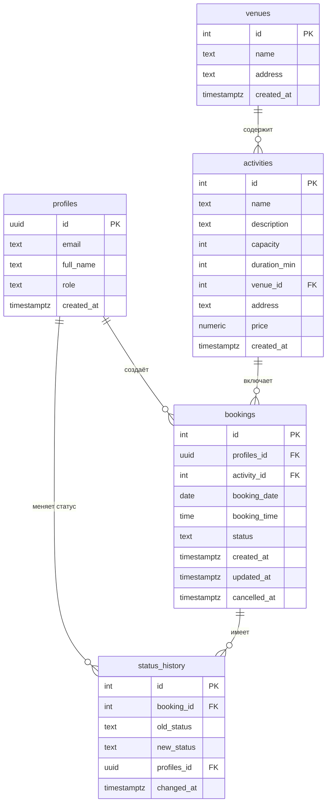

# SportBook — система записи на спортивные занятия

Информационная система для записи на тренировки. Пользователь выбирает
занятие, дату и время, оформляет запись и отслеживает её состояние.
Администратор видит всех клиентов, их записи и аналитику.

## Стек

- HTML + CSS + JavaScript
- Supabase (PostgreSQL + Auth)
- Chart.js (диаграммы в админ-панели)

## Структура проекта

```
EWEWE/
├── index.html          — разметка всех экранов
├── css/style.css       — стили
├── js/config.js        — подключение Supabase
├── js/app.js           — вся логика приложения
├── README.md
├── .gitignore
└── .env.example
```

## ER-диаграмма



## Роли

- **Пользователь** — видит только свои записи, может создавать и отменять.
- **Администратор** — видит всех клиентов, все записи и аналитику.

## Запуск

1. Скачать проект и открыть `index.html` в браузере
   (или через VS Code Live Server).
2. Приложение использует облачную БД Supabase — подключение уже
   настроено в `js/config.js`.
3. Зарегистрироваться → войти.
4. Чтобы стать администратором, в Supabase SQL Editor выполнить:

   ```sql
   update public.profiles
   set role = 'admin'
   where email = 'ваш-email@example.com';
   ```

## Основной сценарий

1. Войти в систему.
2. Открыть «Новая запись».
3. Выбрать занятие, дату и время.
4. Нажать «Записаться».
5. Увидеть уведомление и новую запись в списке.
6. Открыть карточку — увидеть статус и историю изменений.
7. Отменить запись (с подтверждением).

## Проверка

Файл `.env.example` показывает, какие переменные окружения нужны
проекту. Реальный `.env` в репозиторий не попадает (см. `.gitignore`).

## Лицензия

Учебный проект. Свободное использование в образовательных целях.